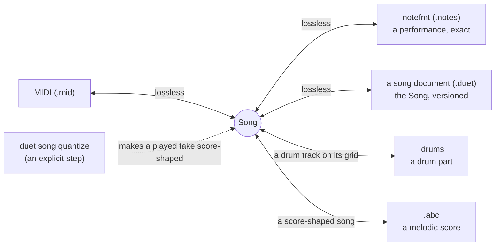

# duet

Tooling for writing and editing music together with an LLM.

LLMs can't read MIDI, and the text formats that do exist either quantize (ABC) or speak
in ticks and note numbers (midicsv). **duet** is the tool for that. Its first format,
**notefmt**, turns a MIDI file into one readable note per line, in bars, beats and note
names, and turns it back into MIDI without losing a tick. Its second, the **drum grid**,
writes a drum part as one row per drum and one column per step. It also reads and writes
**ABC**, the shared score format, through the part of ABC a song can hold exactly, and
refuses the rest by name.

The workspace is split by domain:

| Crate | Holds |
|---|---|
| `duet-core` | the `Song` every format converts through, quantizing, and the notefmt text |
| `duet-midi` | reading and writing Standard MIDI Files |
| `duet-drums` | the drum grid, its lane maps, and grid ⇄ `Song` |
| `duet-abc` | a subset of ABC 2.1 ⇄ `Song`, and the corpus that checks it against abc2midi |
| `duet-play` | a `Song` as timed MIDI events, and a SoundFont synth that renders them |
| `duet-dsp` | audio analysis, samples to events: notes, hits, tempo, meter, key; no I/O |
| `duet-capture` | decoding a take, and assembling `duet-dsp`'s events into a `Song` and score |
| `duet-schemas` | documents: the envelope, versioned kinds, `.duet` and `.duet.jsonl`, the version policy |
| `duet-cli` | the `duet` binary |

## How the formats fit together

**ABC is a score, and notefmt is a performance.** They are different kinds of text, and the
`Song` sits between them. Every format converts through one in-memory `Song`: notes at
bar.beat.tick positions with exact tick lengths, velocities, channels, programs, controls,
and tempo, meter and key changes. notefmt is the text form that shows a `Song` exactly. The
drum grid and ABC are readable, grid-shaped views of part of one, for discussing it.



- **notefmt holds whatever MIDI holds that duet keeps.** A note can start 10 ticks late, last
  0.98 of a beat, have velocity 103, or overlap another note; a track can sit on channel 10,
  with sustain pedal and pitch bend. Nothing has to fit a grid. That is what a sung or tapped
  idea looks like after capture, and what a take from a DAW looks like. MIDI ⇄ notefmt never
  loses anything duet keeps.
- **ABC holds a score.** Lengths are fractions of a unit note, bars are full, pitches are
  spelled against a key, and velocity is one of eight dynamics. ABC also carries notation a
  performance has no use for: repeats, slurs, beaming, annotations. It is the format people
  and LLMs already read and talk about as music. ABC → `Song` → ABC keeps every note of the
  subset duet reads; notation-only marks are listed and dropped, and repeats come back written
  out.
- **Writing ABC works only for a song that is already score-shaped.** A played take is
  refused by name, naming the note, and never snapped quietly. Quantizing is a step you
  choose: `duet song quantize`, then `duet abc write`.
- **The drum grid is the same idea for drums**, which ABC refuses. ABC covers pitched lines.

| | notefmt `.notes` | `.drums` | `.abc` |
|---|---|---|---|
| What it is | a performance, exact | a drum part on a step grid | a melodic score |
| Unit | ticks | steps | fractions of a note |
| Velocity | any, 1 to 127 | three levels as text (any in a drum-grid `.duet`) | eight dynamics |
| Lossless with `Song` | yes | for what fits the grid | for the subset |
| For | capture, DAWs, exact edits, diffs | discussing a groove | discussing and sharing a tune |

notefmt is also where anything is checked exactly. The ABC tests compare in it: abc2midi's
reading of each corpus tune is committed as notefmt text. That is how abc2midi's
undocumented habit shows: every note one tick late and one tick short (`1.1.1  C4  0.998`),
which ABC itself could not express.

## notefmt

```
# notefmt v1: positions are bar.beat.tick, lengths are quarter notes
title "Sketch in D minor"
tpq 480
tempo 92
time 4/4
key D minor

[track "Piano" ch1 prog0]
1.1.0     cc64  127
1.1.0     D4    1      80
1.2.0     F4    0.5    72
1.2.240   A4    0.5    75
3.1.0     D4    0.333  80
3.1.160   E4    0.333  76

[track "Bass" ch2 prog33]
1.1.0     D2    2      90
1.3.0     A1    2      84
```

The full example is [samples/sketch.notes](samples/sketch.notes).

### Install and run

```sh
cargo install --path crates/duet-cli

duet convert take.mid take.duet                  # MIDI to a song document
duet convert take.duet take.mid                  # and back
duet convert take.mid take.notes --to text       # MIDI to notefmt text
duet convert take.notes take.duet --from text    # text to a document
duet song show take.duet                         # print as text
duet song quantize take.mid take-q.mid --grid 1/16   # a copy snapped to sixteenths
```

**A file's envelope means the same to every command.** A `.duet` file is a duet document,
read by its envelope: the kind it names decides what it is, never the file's name, so a
command that reads a song refuses a document of another kind, naming the kind. `.mid`
(`.midi`, `.smf`) and `.abc` are the outside formats, read and written by their names. No
other name means a format. notefmt text is a view of a song, so a `.notes` file is read only
when `--from text` says so, and written with `--to text`. `.json`, `.toml`, `.drums.json` and
`.drums.toml` are no longer read or written: a song document's body is what a song's `.json`
held. Use `-` for standard input or output: standard input is a document when its first
non-blank byte is `{`, and otherwise the command's default (`--from` names it: `duet`, `midi`,
`abc` or `text`). `convert` reads and writes [drum grids](#drum-grids) too, with `--from drums`
and `--to drums`; writing one needs `--grid`.

### The text format

**Header**, before the first track. Every line is optional; the defaults are 480 ticks
per quarter, 120 bpm and 4/4. A header line after a `[track]` line is an error: tempo, meter and
key are the whole song's, so they are never written inside a track.

| Line | Meaning |
| --- | --- |
| `title "Name"` | Song name: the MIDI sequence name (see below) |
| `tpq 480` | Ticks per quarter note: the file's resolution |
| `tempo 92` | Tempo at the start, in quarter notes per minute |
| `time 6/8` | Time signature at the start |
| `key D minor` | Key at the start (`Dm`, `Bb major`, `Bb` also work), or a mode: `key D dorian` |
| `tempo 96 at 9.1.0` | Tempo change |
| `time 3/4 at 17.1.0` | Time signature change |
| `key A minor at 33.1.0` | Key change |
| `end 41.1.0` | Where the song ends, when it says (see below) |

**Tracks** start with `[track "Name" ch1 prog0]`: a name, a MIDI channel from 1 to 16 and
optionally the General MIDI program (0 to 127) at the start. Then one event per line:

| Line | Meaning |
| --- | --- |
| `3.2.240  F#4  0.5  80` | Note: position, pitch, length, velocity (1 to 127) |
| `5.1.0  cc64  127` | Controller: number and value (64 is sustain, 1 the mod wheel) |
| `5.3.0  bend  -2048` | Pitch bend, -8192 to 8191, 0 is none |
| `9.1.0  prog  5` | Program change later in the track |

- **Positions** are `bar.beat.tick`, as a DAW shows them. Bars and beats count from 1. A
  beat is the time signature's denominator (a quarter in 4/4, an eighth in 6/8), and the
  tick is the offset into the beat in the file's own ticks: at 480 tpq, `1.2.240` is an
  eighth note after beat 2. `1.2` means `1.2.0`, and offsets past the end of a beat carry
  on (`1.1.960` in 4/4 is read as `1.3.0`).
- **Pitches** are scientific pitch names with middle C (MIDI 60) as `C4`. Sharps and flats
  both work (`F#3`, `Bb2`). When reading MIDI, black keys are spelled the way the scale of
  the key in force where the note starts spells them, so D minor gives `Bb` and `C#`, and
  after `key A major at 9.1.0` the same keys are `A#` and `C#`.
- **Lengths** are in quarter notes, whatever the time signature: `1`, `0.5`, `1.5`, or a
  fraction like `1/3` for a triplet.
- Lines starting with `#` are comments, and so is anything after a word that starts with `#`.

### Where a song ends

A song names its end with `end`, a position like any other: `end 9.1.0` is the bar line
before bar 9, and `end 8.3.0` stops halfway through bar 8, for a pickup ending. Every format
keeps it: the header line in text and drum grids, `end` in a song document's body, and MIDI's
end of track, where every track ends.

**Every file `duet` writes states its end**, so a file shared between people means the same
on every machine, whatever defaults each has set.

- A note may end exactly on the end. Anything past it is refused, naming it and the end:
  `track 'Piano': the D4 at 8.4.0, which ends at 9.1.240, lies past the song's end at 9.1.0`.
  That goes for notes, controls and tempo, meter or key changes, when reading, writing MIDI
  and quantizing. Nothing is cut to fit.
- A song that names no end gets the default: the bar line after the last bar holding a
  note or control, and never before a tempo, meter or key change. `duet.toml` can change
  the default (see [Configuration](#configuration)). A file written from it states that
  end, so it reads the same wherever it goes.
- Reading MIDI, the file's end (its latest end of track) becomes the song's when some
  track's end of track comes after the event before it, or when it lies past every event
  kept. A file whose tracks each end exactly at their last event cannot say whether it means
  an end there or none, so it reads as naming none and the default applies; the music is
  the same either way.

### Exact round-trips

Reading a MIDI file and writing it back keeps every note to the tick: start, length, pitch,
channel and velocity. Lengths and tempos are written as the shortest decimal that converts
back to exactly the same ticks and microseconds (a triplet eighth at 480 tpq is 160 ticks,
written `0.333`), so nothing drifts however many times a file goes through text.

Kept: notes, tempo changes, time signature changes, key signatures, track names, program
changes, controllers, pitch bend, and the file's end (above). A key in a mode other than
major or minor (dorian, phrygian, lydian, mixolydian, locrian) is written as its key
signature plus a `duet:key D dorian` text event, which is read back; other programs see the
signature.

Dropped: aftertouch, SysEx, markers, lyrics and other text events, and note-off velocity.
A MIDI track that mixes channels (as format 0 files do) becomes one track per channel, and
files are always written as format 1, with the title, tempo, meter and key in the first track.

The title is the sequence name, which MIDI keeps as a track name: the name of a format 1
file's first track when that track holds no notes, or of the only track in a format 0 file.
A format 0 file's tracks have no names of their own, so they are named `Channel 1`,
`Channel 10` and so on.

Names are text. A track name or title whose bytes are not UTF-8 (an old file written in
Latin-1, say) is read with each invalid byte replaced by `�` (U+FFFD), so that name is not
written back byte for byte. Notes and everything else above are unaffected.

One thing MIDI cannot hold: a note that starts after another note of the same pitch and
channel and ends before it. MIDI has no note ids, so its note-off would end the outer note
instead. Converting such a song to MIDI is an error that names both notes. Notes that only
overlap, or that start together, are kept exactly.

Nothing is quantized unless you ask: played timing comes through as it was played.

### Quantizing

`duet song quantize` (or `Song::quantized` in the library) writes a copy with every note's
start and end moved to the nearest point of a grid. The input is never changed.

- The grid is written `1/16` for sixteenths or `1/8t` for triplet eighths. A grid whose step
  is not a whole number of the file's ticks is refused, naming the grid and the resolution.
- The grid restarts at every bar line, so bar lines are always on it. In a bar cut short by
  a time signature change, the last step before the bar line is short.
- A tick exactly halfway between two grid points goes to the later one.
- A note that would collapse to zero length gets one step instead, so no played note
  disappears. A note that was already zero length stays that way.
- Pitch, velocity, track and note order are kept. Controls, tempo, key and time signature
  changes are not moved.
- Two notes of the same pitch can end up one inside the other. Writing those to MIDI is
  refused by name, as above; quantize to text to see and fix them.

### As a library

```rust
use duet_core::Song;
use duet_midi::Midi; // adds Song::from_midi and Song::to_midi

let song = Song::from_midi(&std::fs::read("take.mid")?)?;
let text = song.to_text();
let back = Song::from_text(&text)?.to_midi()?;

// A song document (.duet), through duet-schemas:
use duet_schemas::{Document, Tool};
let doc = Document::new(Tool::new("my-tool", "1.0"), song).write()?;
let song = Document::<Song>::read(&doc)?.body;
```

`Song`, `Track`, `Note` and `Control` derive serde's `Serialize` and `Deserialize`, so any
serde format works. Positions, pitches, keys and time signatures serialize as the same
strings the text format uses.

## Drum grids

```
# notefmt drums v1: one row per lane, one column per step, | at bar lines
title "Groove in D"
tpq 480
tempo 96
time 4/4
grid 1/16
map gm

[bars 1-2]
#         1 . . . 2 . . . 3 . . . 4 . . .   1 . . . 2 . . . 3 . . . 4 . . .
crash   | X . . . . . . . . . . . . . . . | . . . . . . . . . . . . . . . . |
hh      | x . x . x . x . x . x . x . x . | x . x . x . x . x . x . x . . . |
hh-open | . . . . . . . . . . . . . . . . | . . . . . . . . . . . . . . x . |
snare   | . . . . X . . . . . . g X . . . | . . . . X . . . . . . . X . g . |
kick    | X . . . . . . X . . X . . . . . | X . . . . . . X . . X . . X . . |
```

That is [samples/groove.drums](samples/groove.drums). A drum grid is a matrix: one
velocity per lane and step over the whole grid, 0 for no hit, with each bar's step count.
That is its text form. Its document is a drum-grid `.duet`, which holds the matrix itself:
`bar_steps` and one lanes × steps tensor, `vel`, so it keeps any velocity from 1 to 127.

```sh
duet drums render groove.drums groove.mid        # to MIDI (or a song .duet, or --to text)
duet drums read take.mid take.duet --grid 1/16   # a song's drum track to a drum-grid document
duet drums read take.mid take.drums --grid 1/16  # or to the grid's text
duet drums snap take.duet take.drums             # velocities snapped to g, x and X
duet drums lanes                                 # the lanes and their keys
```

The grid side of each `duet drums` command (`render`'s input, `read`'s output, `snap`'s both)
is a drum grid: a `.duet` is a drum-grid document, read by its envelope, and any other name is
the grid's text. A name that is something else is refused rather than misread: a song's
(`.mid`, `.abc`), a stream (`.duet.jsonl`), or `.json` and `.toml`. A song document there is
refused, naming its kind. The song side is a song's, as for every other command.

`duet convert` goes between grids and every other format as well, by the same code:
reading a grid it writes what `duet drums render` writes, and writing one from a song it
takes `duet drums read`'s `--grid`, `--track`, `--bars` and `--snap-levels`, and writes and
refuses what `duet drums read` does.

```sh
duet convert groove.drums groove.mid --from drums              # the same as drums render
duet convert take.mid take.duet --grid 1/16                    # the same as drums read
duet convert groove.drums groove.duet --from drums             # text to a drum-grid document
duet convert groove.duet copy.drums --to drums                 # and back to text
duet convert groove.drums sixteenths.drums --from drums --to drums --grid 1/16  # re-stepped
```

A `.duet` output keeps what was read: a grid read (a drum-grid document, or a grid's text with
`--from drums`) is written as a drum-grid document, and so is a grid made from a song with
`--grid`. A song is written as a song document; `duet drums render` makes a song of a grid.

Writing a grid from a song without `--grid` is refused, naming it: the step is never
guessed. From a grid to a grid, with no `--grid`, the grid is copied as it is, read and
written as `drums snap` does but without snapping: a lane with no hits, the grid's own
`vel` levels and, in a document, any velocity survive. A velocity off the levels is refused as
text unless `--snap-levels` is given. With `--grid`, the grid goes through a
song at that step, as `drums render` then `drums read` would, so lanes with no hits are
dropped. A grid flag that would do nothing (`--track` or `--bars` without `--grid` from a
grid, or any grid flag for an output that is not a grid) is refused too, so no flag is
silently ignored.

**Header.** The notefmt header lines (title, tpq, tempo, time, key and their `at`
changes) mean what they mean in notefmt, plus:

| Line | Meaning |
| --- | --- |
| `grid 1/16` | One step (required): `1/16`, `1/8`, `1/8t` for triplet eighths, and so on |
| `map gm` | The lane map the rows are named from; `gm` is the default and the only one |
| `lane shaker-2 82` | Adds a lane, or moves a map lane to another key |
| `channel 10` | The MIDI channel, when it is not the map's (10) |
| `vel g 40 x 90 X 120` | The velocities the cells stand for, when they are not these |
| `end 3.1.0` | Where the grid stops: the bar line after its last bar, or a step inside that bar |

The writer always states the end. An `end` inside the last bar must be on a step, and the
cells from that step on must be rests. An `end` that contradicts the bars, before the last
bar or past it, is refused by name, and so is a tempo, meter or key change past the end.

**Blocks.** `[bars 1-4]` holds rows for those bars. Blocks cover every bar in order from
bar 1, so an empty bar is written as rests, and every block lists the same lanes in the
same order. A row is a lane name, then each bar's cells between `|`s. A cell is `.` (no
hit), `g` (ghost), `x` (hit) or `X` (accent), separated by single spaces. Each bar's cell
count is checked against its meter, and a wrong count names the line, lane and bar:
`line 14: snare, bar 2 has 15 steps; 4/4 at 1/16 needs 16`. The `#` row counting beats is
a comment, written to help find "the and of 3".

**Every bar must be a whole number of steps**, so 7/8 needs a grid of `1/8` or finer, and
a grid that does not fit is refused by name.

**Lanes.** The `gm` map has a lane for every General MIDI Level 1 percussion key, 35 to
81, on channel 10, with names that are never note names: `kick` 36, `sidestick` 37,
`snare` 38, `clap` 39, `rimshot` 40, `hh` 42, `hh-pedal` 44, `hh-open` 46, `crash` 49,
`ride` 51, the toms from `tom-high` 50 down to `tom-floor` 41, and so on. `duet drums
lanes` lists them all with their aliases (`bd` for `kick`, `oh` for `hh-open`); a file may
use an alias, and the grid then uses the lane's own name. Rows are written cymbals first,
then hats, toms, snare, kick and percussion. A user's or project's `duet.toml` can add lanes, move them and give them aliases (see
[Configuration](#configuration)).

**To and from a song.** Rendering gives one track named `Drums` on the grid's channel:
each hit is a note on its lane's key, one step long, with its velocity. Reading a song
takes its drum track (the one on channel 10, or the one `--track` names) and keeps only
note starts and velocities: lengths, controls and other tracks are left out, and `duet`
says how many. Nothing is moved to fit. A note off the grid (quantize it first, with
`duet song quantize`), on a key no lane plays, or on the same lane and step as another is
refused by name. The grid runs to `--bars` when it is given, or else to the song's end, the
one it names or its default (a mid-bar end, which must be on a step, becomes the grid's
`end`). `--bars` never cuts anything: a hit or a tempo, meter or key change past it is
refused by name.

Rendering gives the song the grid's end, so trailing empty bars and a mid-bar end survive.

Grid → song → grid gives back the same grid, through MIDI too, with no bar count asked for,
trailing empty bars and a mid-bar end included, when its lanes are in the map's row order
and each is played at least once, as the writer leaves them.

**Velocities.** The text holds three levels. Writing a velocity that is not one of them as
text is refused, naming the lane, bar and step; keep it in a drum-grid `.duet`, or snap it
to the nearest level with `--snap-levels` when reading (or `duet drums snap`). A velocity
exactly halfway between two levels goes to the louder one. Nothing snaps unless you ask.

## ABC

```sh
duet abc check tunes.abc                      # what each tune holds that a song does not carry
duet abc render tunes.abc tune.mid --tune 2   # one tune as MIDI (or .duet, or --to text)
duet abc write take.duet take.abc --unit 1/4  # a song as ABC, X:1
duet convert tune.abc tune.mid                # .abc works both ways, for a file of one tune
```

`duet-abc` reads a subset of [ABC 2.1](https://abcnotation.com/wiki/abc:standard:v2.1):
header fields, notes, octaves, accidentals, lengths, rests and multi-bar rests, bar lines,
ties, broken rhythm, tuplets up to `(9`, chords, repeats and endings (unfolded), inline
`[M:]`, `[L:]`, `[Q:]` and `[K:]`, keys with a mode, voices, `%%MIDI program` and
`%%MIDI channel`, the dynamics `!ppp!` to `!fff!`, and several tunes per file. A pickup is
a short first bar of its own time signature, so its notes keep abc2midi's ticks exactly.

**Notation only.** Slurs, annotations, information fields such as `C:` and `N:`, voice
properties other than the name, other `%%` directives and the spacer `y` are read and not
carried into the song. `duet abc check` lists each with its line, and `render` says how many
there were.

**Refused by name.** Everything else is refused with its line and column and the name of
the construct: grace notes, decorations other than dynamics, chord symbols, lyrics, parts,
`K:none`, clefs and transposition, `%%MIDI` commands other than program and channel, and
the rest of the table in `duet_abc::REFUSED`. Two constructs are refused because the
standard and abc2midi read them differently: a bare `Q:120`, which the standard reads as
unit lengths per minute and abc2midi as quarters (write `Q:1/4=120`), and a tune with no
`M:`, which is free meter in the standard and 4/4 in abc2midi. A bar of the wrong length is
an error naming the bar; abc2midi plays it as written, without a warning.

**One place duet parts from both.** A `:|` with no `|:` goes back to the start of the tune,
in the standard and in abc2midi, so a pickup is replayed there (abc2midi warns of the short
bar). A song cannot hold a short bar in its middle, so duet goes back to the first full bar
after the pickup instead. Write `|:` after the pickup and all three agree.

**Writing.** Nothing is quantized. A note off the 1/64-note grid that is not in a triplet
group (three equal slots filling whole beats, each note one or two of them) is refused,
naming its track and position (quantize it first with `duet song quantize`). So are a velocity that is not a dynamic's level
(`--dynamics nearest` snaps it, and the ABC says so in a comment), a tempo that is not a
whole bpm, a track on channel 10 (drums are the drum grid's), and notes that overlap
without starting and ending together. ABC needs a key, so a song with none is written in C
major. The ABC written is canonical: reading it and writing it again gives the same text.

**Where it comes from.** `duet-abc` was written from the ABC 2.1 standard and from
abcMIDI's documentation of how abc2midi plays what the standard leaves open. No abcMIDI
source file was opened, and none is copied. abc2midi is only ever run as a separate
program, on a developer's machine, to check this crate's reading (see Development).

## Playing a song

```sh
duet play take.duet                        # through the built-in synth, to the speakers
duet play take.mid --soundfont GM.sf2      # with a SoundFont of your choosing
duet play take.duet --port "IAC Driver"    # to a MIDI port: Logic, a synth, a DAW
duet play take.notes --from text           # notefmt text, named as such
```

- **The built-in synth** sounds the song with a General MIDI SoundFont (`.sf2`): every note
  at its position, length, pitch, channel, program and velocity, with its controls and tempo
  changes. Channel 10 is drums. It needs nothing else running.
- **The SoundFont** is `--soundfont`, else `[play] soundfont` in duet.toml, else the one duet
  installs: `default.sf2` in the data directory (`~/.local/share/duet` on macOS and Linux, or
  `$XDG_DATA_HOME/duet`; `%APPDATA%\duet\data` on Windows; or whatever `DUET_DATA_DIR` names),
  or in `share/duet` beside the binary's directory. With none, `duet play` fails saying where
  it looked; it never plays silence.
- **`--port`** sends the same events, at the same times, to a MIDI port instead, with no
  SoundFont. Give the port's name, or a part only one port's name holds, in any case. On
  macOS a port exists only while the app that owns it runs, such as Logic, or the IAC Driver
  once it is enabled in Audio MIDI Setup. An unknown name lists the ports there are. If
  playing stops early, on Ctrl-C or a failed send, duet turns off every note it left
  sounding and the sustain pedal on each channel it used.
- **What plays is the song's MIDI file**, exactly as `duet convert take.duet take.mid` writes
  it, with every track merged. At one moment, notes ending come before programs and controls,
  and those before notes starting, so one track's note never cuts off another's. MIDI cannot
  say which of two overlapping notes on one key a note-off ends, so the key is held until the
  last of them ends: each note sounds at least to its own end. The synth renders in blocks of
  64 samples, so an event sounds within 1.5 ms of its time.

## Capturing an idea

```sh
duet capture melody idea.m4a                    # idea.notes, idea.abc, idea.capture.json
duet capture rhythm tap.wav --lane hh           # a tapped take: every hit in one lane
duet capture rhythm beatbox.flac --tempo 96     # a beatboxed take: kick, snare and hat
duet capture melody idea.m4a --key Eb --downbeat 0.4 -o scratch/idea
```

A recording of a sung, hummed or single-note played melody, or of a tapped or beatboxed
rhythm, becomes the text the rest of duet reads. Both commands take one recording and these
options; everything about the timing that is left out is estimated and stated.

- **`--tempo <bpm>`** is in quarter notes per minute, used exactly. A melody's must be a whole
  number, because its ABC states the tempo as `Q:1/4=<n>`; a fractional one is refused before
  analysis starts. A rhythm accepts any tempo.
- **`--meter <m>`** is the meter, such as `4/4` or `6/8`, used exactly.
- **`--downbeat <seconds>`** is where bar 1 starts, in seconds from the start of the recording.
- **`--key <key>`** is a melody's key as ABC's `K:` names it (`Eb`, `Bm`, `F#m`), used exactly.
  A rhythm take has no key, and `--key` is refused for one.
- **`--grid <step>`** is the step the score is quantized to, such as `1/16` (the default) or
  `1/8t`. The `.notes` is never quantized.
- **`--lane <name>`** (rhythm) puts every hit in that lane, such as `hh` or `kick`. It is how a
  tapped take is read; without it a rhythm take is read as beatboxed. Lane names resolve
  through the configured lane map, so aliases from `duet.toml` apply. A melody's notes are
  pitched, not in lanes, and `--lane` is refused for one.
- **`-o`, `--output <stem>`** is the output files' stem. Without it, the input's name without
  its extension, beside the input.

**Files written.** Three, all beside each other, and none ever overwrites a file that exists
(the whole capture is refused before anything is written). Once the take is analysed, the
`.notes` and the `.capture.json` are always written; if the score then cannot be, that is
reported after them, and they stay:

- `STEM.notes`: the exact performance, unquantized, at the detected times. Quantizing never
  replaces it.
- `STEM.abc` for a melody, or `STEM.drums` for a rhythm: the score, the `.notes` quantized to
  `--grid`.
- `STEM.capture.json`: the analysis. Every onset, note and hit, in sample frames at the
  stated rate (22 050 Hz; divide by it for seconds); the timing (tempo, its half and double,
  the measured beat period, meter, downbeat, each marked given or estimated, with a
  confidence); a melody's key, with its pitch-class histogram and every key's score; the tempo
  from each beat to the next, so drift is a series and not a feeling; and how far quantizing
  moved each note, in milliseconds and in grid steps.

**Formats.** WAV, FLAC, MP3, Ogg Vorbis and AAC in M4A are read, a packet at a time, so a long
take is never held in memory whole. A damaged stretch that cannot be decoded is heard as silence
of its true length, so every note after it keeps its time. A file that is not audio, or uses a
codec duet cannot decode, is refused naming the file and the codec. HE-AAC is refused by name
when the file's header declares it. Known limit: HE-AAC signalled only inside the audio data, with a plain
AAC-LC header, decodes as AAC-LC at half bandwidth without a refusal. Catching it would mean
comparing the declared and decoded sample rates, which capture does not do.

**What is estimated, and how it is said.** The tempo, the meter, the downbeat and a melody's
key are each given or estimated. A given value is used exactly and never reported as an
estimate. An estimate is applied and stated, on standard error and as comment lines in the
`.notes` and the score (`#` in `.notes` and `.drums`, `%` in ABC), with what you would
reach for if it is wrong: the half and double tempo, the relative major or minor, and in a
compound meter the felt beat. A weak estimate is marked `weak`; a meter that cannot be told
apart is applied as 4/4 and says so. For the synthetic melody in the reference corpus:

```
$ duet capture melody synthetic-melody.flac
tempo: estimated 121 bpm (half 60.5, double 242), confidence 0.53
meter: estimated 4/4, confidence 0.14, weak
downbeat: estimated at 0.255 s, confidence 0.14, weak
key: estimated C major (relative A minor), confidence 0.88
lead-in: none
velocities: 8 snapped to the nearest dynamic's level in the .abc; the .notes keeps them exact
```

The take was made at 120 bpm, so this estimate is a beat a minute fast. A tempo's
confidence is the lesser of how many onsets sit on its beat and how clearly it beat its half
and double, so a take that could as well be read at half the tempo is marked weak.

The tempo is in quarter notes per minute always. The estimate is rounded to a whole bpm for
the score, but **notes are placed by the beat period actually measured**, not by the rounded
tempo, so none drifts off its beat over a long take; playback runs a fraction of a percent off
the recording's real time. A given tempo is used exactly for both. The key changes how notes
are spelled and the signature, never a pitch.

**Rhythm.** Without `--lane`, each hit is sorted by sound into `kick`, `snare` or `hh` (a closed
hat). With `--lane`, every hit goes to that lane. Known limit: a hit has one lane. A kick and a
hat sounded together, or within about 50 ms of each other, are heard as one hit and get one
lane. Takes of different lanes are meant to be put together later; for that, give each the same
`--tempo`, `--meter` and `--downbeat` so they line up.

**Before the downbeat.** A take rarely starts on its first bar line, and no note is dropped
from the score for coming before it. Notes before the downbeat that fit a short bar become a
pickup bar, followed by a change of meter at bar 2. Otherwise bar 1 (or more) is whole bars of
rests holding them. A drum grid always gets the rest bars, because grids number bars from 1
with no gaps. When quantizing leaves nothing in that lead-in, it is removed from the score and
the score says so. Each case is stated (`lead-in: none`, `a pickup of 1/4`,
`1 bar of rests`, `removed from the score`). The `.notes` always keeps the true time.

**Notes that share a step.** A quick run or a flam can put two notes, or two hits on one lane,
on the same step of the grid. The score cannot hold both, so the grid's step is halved (1/16,
then 1/32, then 1/64) until none do, and the grid used is stated:
`grid: 1/16 refined to 1/32, so no two notes share a step`. A `--grid` you give is refined the
same way. What a 1/64 still cannot part is merged into one, each merge stated: a melody keeps
the longest note's pitch, and a rhythm the strongest hit. The `.notes` keeps every note, and the
analysis gives the grid used, which the quantize offsets are counted in.

**Velocity.** A hit's or note's velocity is its strength relative to the take's strongest
(20 to 127). The score writers refuse a velocity that is not one of their levels, so asking for
a score asks for the snap: ABC dynamics are snapped to the nearest, a drum grid's to its
levels, and the count snapped is stated. The `.notes` keeps the raw values.

**Correcting a capture.** Edit the `.drums` or ABC text, which is what they are for. To fix an
estimate, run again with `--tempo`, `--meter`, `--downbeat` or `--key` (add `-o` to keep the
first). Do not fix a wrong key by editing `K:` in the ABC: that changes every pitch written, not
only the spelling. Re-run with `--key`, which changes spelling alone.

**Not in this version.** Chords and polyphony, live input, telling tap timbres apart, and a
tempo that changes within a take (drift is reported in the analysis, not corrected).

**The reference corpus.** `crates/duet-capture/corpus` holds the recordings the capture
tests are measured against, each with a hand-checked transcription. Its
[README](crates/duet-capture/corpus/README.md) says how to add a take.

## Configuration

`duet` reads `duet.toml` and `duet.local.toml` from two places, each file over the ones
before it:

1. the user config directory: `~/.config/duet` on macOS and Linux (or `$XDG_CONFIG_HOME/duet`),
   `%APPDATA%\duet\config` on Windows, or whatever `DUET_CONFIG_DIR` names
2. a project's `.duet/` directory: the nearest one from the working directory up

```toml
[song]
end = { round-up = 4 }   # or "last-bar", the built-in

[play]
soundfont = "GeneralUser.sf2"   # for duet play; a relative path is this file's directory's

[lanes.shaker-2]         # a new lane: it needs a key; it goes in the "other" group
key = 82
aliases = ["sh2"]

[lanes.kick]             # a gm lane: only the fields given change
aliases = ["bd", "boom"]
```

- **`[song] end`** is the end a song that names none gets when a file is written.
  `"last-bar"` is the bar line after the last bar holding a note or control. `{ round-up = 4 }`
  carries that on to the next multiple of 4 bars. The end is always written into the file, so
  someone with other defaults reads the same song.
- **`[play] soundfont`** is the SoundFont `duet play` sounds songs with, over the installed
  one. `--soundfont` is over both.
- **`[lanes.<name>]`** adds a lane to the `gm` map, or changes one. The fields are `key`,
  `group` (one of the map's groups, or `other`) and `aliases`. A file never removes a
  built-in lane, so one that would put two lanes on one key is refused: move the other lane
  too. Each file must leave a valid map.
- **Config lanes are for reading.** A `.drums` row may use a lane or alias config adds, and
  `duet drums read` names notes by the configured keys. Written `.drums` files never depend on
  config: they say `map gm` and carry a `lane` line for every lane the built-in map does not
  name on that key, so they read the same with no config at all.
- **`map gm` is General MIDI on every machine.** When reading `.drums` text, a config that
  moves a gm lane's key or group does not apply: `kick` is still 36 there. The move still
  applies to `duet drums read`, where it describes your kit. `duet` says on standard error
  when a moved key doesn't apply, and `duet config show` lists it. A file's own `lane` line
  still moves a lane.
- A file that breaks a rule (bad TOML, a field `duet` does not know, two lanes on one key)
  is refused, naming the file and the rule.

```sh
duet config path   # the directories, and each file in the order it is read
duet config show   # the merged config as a duet.toml, each value with where it came from
```

## Development

Builds on the latest stable Rust (1.100 or later, edition 2024). On Linux, `duet play`'s
audio and MIDI crates need the ALSA headers: `apt install libasound2-dev pkg-config` (or your
distribution's package).

```sh
cargo test --locked
cargo clippy --locked --all-targets --all-features -- -D warnings
cargo fmt --all --check
```

Beyond cargo, a developer's machine wants a few things CI does not. mise cannot install
abcmidi or FluidSynth (neither has a registry entry), so they are in the `Brewfile`:

```sh
scripts/dev-setup.sh                 # brew bundle, then fetch the pinned SoundFont
scripts/fetch-soundfont.sh           # just the SoundFont, to duet's data directory
scripts/port-check.sh                # duet play --port to FluidSynth, then check what arrived
scripts/port-check.sh --interrupt 4  # the same, with Ctrl-C after 4 seconds
scripts/capture-fixtures.sh [fixtures|corpus|all]   # regenerate duet-capture's audio (macOS)
```

- **The SoundFont** is the one duet's installer will fetch, pinned in `scripts/soundfont.env`
  by commit and sha256: GeneralUser GS 2.0.3. It is never committed. `fetch-soundfont.sh` puts
  it at `default.sf2` in the data directory, so `duet play` sounds with no flags. It keeps a
  file already there with that sha256, and refuses to overwrite any other.
- **`port-check.sh`** (macOS) starts FluidSynth as a CoreMIDI port, sounding what it receives
  through the speakers and logging every event, then plays a song to it with `--port`.
  Played to the end, it passes when every note arrived and no key is left on. Interrupted, it
  passes when duet says it stopped, its last messages reset every channel it used (sustain
  off, all notes off), and no key is left on. This is the only check of `--port` against a
  real port; CI can't open one.
- **`capture-fixtures.sh`** regenerates the generated audio duet-capture's tests use: `fixtures`
  is the decode tests' one-second tones in each format, `corpus` the reference corpus's
  synthetic takes (the default), `all` both. Its encoders (`lame`, `flac`, `vorbis-tools`) are
  in the `Brewfile`; the AAC and HE-AAC files use macOS's own `afconvert`. CI uses the committed
  files, so run it only to change them.
- **`ffmpeg`**, also in the `Brewfile`, is for converting recordings to a format capture reads.
- The Brewfile installs each tool's current version. The abc2midi oracle checks its own
  version against the corpus manifest.

CI also runs `cargo deny`, `cargo audit`, rustdoc with `-D warnings`, a build on the declared
`rust-version`, and the checks for the tasker-systems
[conventions](https://github.com/tasker-systems/conventions) baseline this repository is pinned to
(see [CLAUDE.md](CLAUDE.md) and `.conventions/`).

The round-trip tests in `crates/duet-midi/tests` generate MIDI files with humanized timing,
sustain pedal, pitch bend, tempo and meter changes (including one in the middle of a bar),
overlapping notes, and a format 0 file with several channels, at 96, 384, 480 and 960 ticks
per quarter, and check every kept event survives MIDI to text to MIDI unchanged. Those in
`crates/duet-drums/tests` generate drum grids in several meters (with a change of meter),
grids and resolutions, with any velocity, ending in empty bars or inside a bar, and check
grid → song → grid, through MIDI and drum-grid documents, and the text form all round-trip
unchanged. Every song the MIDI tests build also round-trips through a song document.
`crates/duet-schemas/tests/schemas.rs` is the schema gate. Each kind's JSON Schema, and the
envelope's, is generated from the Rust types and committed under `crates/duet-schemas/schemas/`,
with an example document beside it. The gate fails when a committed schema's shape differs from
the code at the same version (bump the kind's version), and asks only to regenerate when its
descriptions alone changed. Every committed example must still read, and validate against its
schema. To write a new or regenerated schema:

```sh
DUET_BLESS_SCHEMAS=1 cargo test -p duet-schemas
```

`crates/duet-dsp` is the analysis behind `duet capture`, tested on synthesized signals and on
a committed pYIN reading. `crates/duet-capture` decodes and assembles around it; its tests
decode a one-second tone in every format it reads and run the reference corpus through the
pipeline.
`crates/duet-abc/corpus` holds our own ABC tunes, MIT, one per construct the subset reads
plus six whole tunes, each with committed recordings of abc2midi's reading of it and of the
ABC our writer makes from it. CI compares our reading with those recordings
(`crates/duet-abc/tests/oracle.rs`). It never runs abc2midi. On a developer's machine, the
`oracle` feature also runs abc2midi and checks the recordings still match it:

```sh
brew install abcmidi                               # the version in corpus/manifest.toml
cargo test -p duet-abc --features oracle           # fails on any other abc2midi version
DUET_ABC_RECORD=1 cargo test -p duet-abc --features oracle recordings_match_live_abc2midi
```

The last line re-records, for a new corpus tune or a writer change; review its diff. When
our reading disagrees with a recording, re-recording is not the fix: either our reading of
the standard is wrong and is fixed, or abc2midi differs from the standard and the
difference is listed in the manifest with its reason. mise cannot pin abcmidi (no registry
entry, and the project publishes no release binaries), so Homebrew installs it and the
oracle checks its version against the manifest.

`crates/duet-e2e` holds the tests that drive the `duet` binary end to end. It is never
published. Each test run builds the binary with `cargo build -p duet-cli --bin duet` and runs
what that build reports, so a test never runs a stale binary (set `DUET_E2E_BIN` to run
another, such as one built from `main`). Its `golden/` holds what `duet` wrote from the
samples before a song could name an end, and a test checks that every file written now holds
the same music, event for event, and differs only by stating its end. CI runs it again, with
duet-cli's tests, under the hostile config in `crates/duet-e2e/hostile`, so no test reads a
developer's own config.
