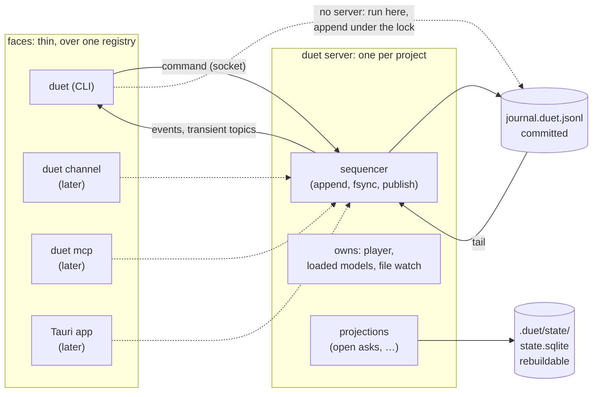

# duet's event bus: a server loop, the journal it writes, and the CLI against it

**Date:** 2026-11-17. **Task:** temper `01a1e563-22e6-70e6-a7ce-8b38e93b3091`.

**Status: Ruled (owner, 2026-11-17).** The direction is ruled (temper
`01a1e9ff-33f4-7123-85d9-7323abead248`), quoted in [The rulings this
builds](#the-rulings-this-builds). This spec designs the mechanism. The owner walked through it in
session the same day and ruled all fifteen of its [decisions](#decisions-for-the-owner), each as
recommended, with 10 refined in discussion. What is still marked **Proposed** is the design those
decisions rest on: the owner ruled the decisions, not each line. It ends with [build
tasks](#build-tasks), each with its witness. Nothing here is built.

**Builds on:**
- [duet documents](2026-11-15-duet-documents-design.md): the envelope, kinds, the `.duet.jsonl`
  framing and the version policy. The journal is a document of that crate.
- [Variants and comps](2026-11-17-variants-and-comps-design.md), ruled: a verdict that picks or
  marks is a comp entry, and "the session record logs the act" (its ruling 5).
- [The project design](2026-11-17-project-design.md) (temper
  `01a1e007-8747-77ee-8333-dd462d6d01eb`), merged as a proposal (#74) and not yet ruled. Its §10
  reserves the paths this spec uses. Where this spec asks for more, it says so in [What this asks of
  the project layout](#what-this-asks-of-the-project-layout).
- The jobs-and-boundaries note (temper `01a1e57c-f9c8-72e5-8a9b-6a4e5874bfdc`), §7 "The bus": acts,
  facts and asks, and the usefulness test.
- The ideation (temper `01a1e9eb-b8f0-724e-be60-0dbeb03137fc`) and the outside facts (temper
  `01a1e9f1-4b5e-726c-9fe7-e1e91d2a7481`) of 2026-11-17.
- The Next goal (temper `01a1da53-b539-76ed-8634-b921104ce3d3`), whose clauses this makes
  witnessable.
- **Prior art in tasker-core** (`tasker-systems/tasker-core`, read at `2483e3a` on 2026-11-17), the
  source the conventions' concurrency rules cite: ADR-002 and
  `docs/development/mpsc-channel-guidelines.md` for bounded channels,
  `docs/architecture/events-and-commands.md` and `actors.md` for the command processor, and
  `docs/architecture/states-and-lifecycles.md` with `crates/tasker-shared/src/state_machine/` for
  state machines.

**Grounding:** the code at `main` (`bb58d0f`): `duet-schemas`' `Stream` and `StreamKind`, the CLI's
project walk-up in `crates/duet-cli/src/config.rs`, and the canonical `clippy.toml` and `deny.toml`.
temper-contrib `apps/desktop/src-tauri/src/acp.rs` and `present_server.rs`, read at `HEAD` on
2026-11-17. Crate versions and licences were read from crates.io the same day.

## The rulings this builds

**Ruled (owner, 2026-11-17)**, from the decision:
1. **A server loop is duet's event bus.** It is wanted for the joy of building it and as a feature,
   so it counts as needed. This replaces the 11-16 "no server is presumed".
2. **The CLI always stands alone** as a complete tool. It may check quickly whether a server is
   running for the project. If one is, it posts its events there and can subscribe.
3. **Bus and CLI first,** as the proving ground. The desktop app is designed after that.
4. **The desktop face is Tauri.** temper-desktop is the prior art.

**Ruled as facts** in the same decision: a cloud session reaches the local bus through Remote
Control's folder attach, where it runs `duet` on the owner's Mac like any local CLI. No other path
(a public URL, a proxied connector) is pursued.

**Open in that decision, ruled here:** [the durable/ephemeral line](#2-durable-and-ephemeral)
(decision 1).

**Carried over from 11-16, ruled there:** duet's functionality is built as actions that submit
events, and events are what anything subscribes to. The session record is an append-only
`.duet.jsonl` stream. An ask carries an id, and its answer names it. A process earns its place by
owning something. The bus's first exercise is the four-moment by-ear review.

## The shape in one picture



The one idea that holds it together, **Proposed:** **the journal file is the sequence.** Every
durable event is a line appended under one lock. The server is the usual writer, but not the only
one: a CLI with no server appends under the same lock, and the server tails the file, so it
publishes those lines too. "Write to the journal before publishing" (the ideation's proposal) then
holds by construction: the server publishes only lines that are already in the file.

## 1. The bus

### Commands in, events out

**Proposed.** The ideation's proposals are kept, with one refinement each.

- **A face submits a command:** an action's name and its typed input, with a command id the face
  mints (UUIDv7). The bus answers it once, by that id. The answer is either `accepted`, listing the
  events it caused by `seq`, or `refused`, naming the refusal as duet already names refusals (a
  newer minor, an existing output, an unknown ask).
- **Events are facts.** They say what happened and what came of it. They never say what someone
  asked to happen, so the journal replays without running anything. A command is not written to the
  journal; the events it caused are, and each one names its `cause`, the command id.
- **A refusal is a reply, and a published topic, but not a journal entry.** *The refinement:* the
  ideation put refusals as events. A refusal changes nothing, so by the test in §2 it is transient.
  It is published, so a face that didn't submit the command still sees "the owner's `comp pick` was
  refused: an existing pick at 2.28". It isn't kept ([decision 4](#decisions-for-the-owner)).
- **Asks and answers by id,** as ruled on 11-16. An ask's id is the id of its `ask.asked` event, and
  `ask.answered` names it. Delivery is now live, but nothing depends on its being live: an open ask
  is an `ask.asked` with no answer in the journal, so a CLI with no server, a cloud session reading
  a clone, or a restarted server all see the same open asks.

### The action registry

**Proposed.** There is one registry in a library crate (`duet-actions`, [§6](#6-crate-boundaries)).
Each action declares:

| Field | What it is |
|---|---|
| `name` | dotted, stable: `capture.melody`, `comp.pick`, `ask`, `answer`, `play` |
| `input` | a Rust type with `JsonSchema`, so the CLI's clap arguments, an MCP tool's `inputSchema` and the app's form all come from one type |
| `emits` | the event kinds it may cause |
| `runs` | `anywhere` (the default), or `server` when it needs a resource only the server owns |
| `writes` | which outputs it may create, and whether an input can ask to replace an existing file |
| `run` | `fn(&Context, Input) -> Result<Outcome, Refusal>`, where `Context` gives the project root, the actor and an event sink |

- **`runs: anywhere` actions execute where they are invoked.** That includes everything today's CLI
  does. When the CLI is joined to a server, it still runs `capture melody` in its own process, then
  posts the events. So a joined run and a standalone run execute the same code and write the same
  files. The only difference is who appends the line. That contains the ideation's "two code paths"
  risk: there is one execution path and two sequencing paths, and the sequencing paths share the
  journal writer.
- **The rule, in the owner's words (ruled, decision 10):** the point is that every face uses "the
  same actions and event mechanisms and journal mechanics so that the same thing happens regardless,
  not that we make the server do things for the CLI when the CLI can do it just fine".
- **A long action publishes `progress`.** A joined CLI running a capture sends a transient
  `progress` topic to the server, so Claude's watch and the app see a long action's progress too,
  not only the terminal that started it.
- **`runs: server` actions** are the ones that need what the server owns: playing to the owner's
  device while another face controls it (`play`, with `stop` and `seek`), and later, inference on a
  model the server keeps loaded. An action also moves to the server when it needs a control that
  crosses faces, such as cancelling it from another window. Moving one is a change to its `runs`
  field and to how its inputs and outputs cross the socket: its code is in `duet-actions` either
  way, and the server calls the same `run`. Each one states what it does with no server. `play`
  plays in the CLI's own process, as today. `wait` reads the journal
  ([§3](#the-commands-the-cli-adds)).
- **Every face is thin.** The CLI maps clap to an input, MCP maps a tool call, and the app maps a
  `#[tauri::command]`. "The same tools" then holds by construction, as the ideation proposed. A
  registry witness checks it: every registered action has a CLI path, and every CLI subcommand that
  changes files is a registered action.

### Sequencing and resuming

**Proposed.**

- **One lock orders appends:** `.duet/run/journal.lock`, an advisory exclusive `flock` taken for
  each append. Under the lock, the writer writes one whole line with one `write(2)` and calls
  `fdatasync` before releasing it. The server publishes only after that.
- **`seq` is the event's ordinal in the file:** line 2 is `seq` 1, since line 1 is the head. It is
  not stored in the line ([decision 3](#decisions-for-the-owner)). What a line stores is its `id`
  (UUIDv7), which is unique across machines.
- **A subscriber resumes from a cursor `(seq, id)`.** The server checks that the line at `seq` has
  that `id`, and sends everything after it. If the line differs, because the journal was merged or
  rewritten under it, the server sends `resync` and the subscriber starts over from `seq` 0. A
  subscriber is never told "you are up to date" when it isn't.
- **Transient topics have no cursor.** A subscriber that joins late gets the latest value of each
  (where the playhead is, who is present), never their history.

### Lifecycles as state machines

**Proposed**, after tasker-core's task and step state machines.

**A word on names first.** tasker-core's state-machine "events" (`Start`, `Cancel`) are inputs. In
this spec those are **commands**. duet's journal entries, its **events**, are facts, closer to the
transition rows tasker-core appends to `task_transitions`.

**Each lifecycle is an enum and one function.** The function is `transition(state, event) ->
Result<State, Refusal>`, a single `match` on the current state and the event. An arm that isn't
listed refuses, naming why. A terminal state never changes. The lifecycles:

| Lifecycle | States | Terminal |
|---|---|---|
| an ask | `open` → `answered` or `withdrawn` | `answered`, `withdrawn` |
| the server | `starting` → `replaying` → `serving` → `draining` → `stopped` | `stopped` |
| the player | `idle` ⇄ `playing` | none |
| a CLI run in a project | `probing` → `joined` or `standalone` | both, for that run |

Only the ask's lifecycle is in the journal. The others are in-process and transient.

**The check and the append are one step under the journal lock** ([decision
13](#decisions-for-the-owner)). This is duet's form of tasker-core's guard and write in one
transaction, and of CONC-DB-1's compare-and-set. A writer:
1. takes `.duet/run/journal.lock`;
2. folds in any lines appended since it last read;
3. runs `transition` on the result;
4. appends the event only if the transition is allowed;
5. releases the lock.

So when two processes answer one ask at once, the second to take the lock sees the first's answer
and is refused `already-answered`. Without this, each would check, both would find the ask open, and
both would append. A long action, such as a capture, runs outside the lock; only the check and the
append are inside it.

**Replay is lenient where a live command is strict.** **Ruled (owner, 2026-11-17,** in review of
this spec). Replay folds the journal through the same `transition`. A transition that fails there
can only come from a union merge of two clones or a hand edit, such as two answers to one ask. It is
skipped, the first in file order wins, and `duet journal check` lists it. It is never fatal.

**Who acted is recorded, never enforced.** `by` is an audit label. tasker-core learned this in
TAS-54: it enforced which processor owned a task, which blocked crash recovery, and it now records
the processor for audit only.

**The machines stay small.** tasker-core's transition table has gathered legacy arms. duet's journal
is kept forever, so every transition ever written must still replay. A change to a lifecycle is a
new event version, never an edit to an old arm.

### The wire

**Proposed.** A Unix-domain stream socket carries newline-delimited JSON, one message per line, the
same shape as a `.duet.jsonl` line, so the same tools read both.

```jsonc
// client → server, first line
{"hello": {"bus": 1, "tool": {"name": "duet", "version": "0.4.0"}, "by": {"who": "claude", "face": "cli"}}}
// server → client
{"welcome": {"bus": 1, "tool": {"name": "duet", "version": "0.4.0"}, "project": "wayfaring",
             "journal": {"kind": "journal", "version": "1.0", "last": {"seq": 41, "id": "0196…"}},
             "registry": "fnv1a:9c04e1b2a7d35f60"}}

{"submit": {"id": "0196…c1", "action": "answer", "input": {"ask": "7f3a", "answer": "two", "said": "a new word"}}}
{"accepted": {"id": "0196…c1", "events": [42]}}          // or
{"refused": {"id": "0196…c1", "refusal": {"name": "unknown-ask", "message": "no open ask matches 7f3a"}}}

{"subscribe": {"from": {"seq": 41, "id": "0196…"}, "events": ["ask.*", "comp.*"], "topics": ["presence"]}}
{"event": {"seq": 42, "line": { /* the journal line, verbatim */ }}}
{"topic": {"name": "playhead", "value": {"take": "wayfaring", "at": 2.31, "playing": true}}}
{"resync": {"reason": "the line at seq 41 is not 0196…"}}
{"lagged": {"seq": 57}}                                     // then the server closes; resume from 57
```

- **`bus` is the wire's own integer version.** It is separate from the journal's kind version and
  from duet's version. The server refuses a `hello` with another `bus` by name. The CLI then runs
  standalone and says so ([§3](#the-cli-joined-or-standalone)).
- **`registry` is a digest of every action's name and input schema.** A CLI whose registry differs
  from the server's (a newer duet in the shell, an older server still running) does not submit. It
  runs standalone and says why. The server still sees what it wrote, by tailing the journal.
- **Backpressure:** a subscriber too slow for durable events is sent `lagged` and disconnected. It
  loses nothing, because it resumes from the journal. A slow subscriber to a transient topic only
  ever sees that topic's latest value. Every channel behind this, its size and what happens when it
  is full are in [The server's channels](#the-servers-channels).
- **Authentication is the filesystem.** The socket sits in a directory the server creates `0700`,
  and the socket is `0600`, so only the owner's user connects. That covers a cloud session through
  the folder attach, which runs as the owner on the Mac. No secret is needed on the socket. A later
  TCP face (MCP over streamable HTTP, [§7](#7-later-faces-sketched-only)) takes temper-desktop's
  secret header, compared in constant time (SEC-CRED-3).

## 2. Durable and ephemeral

**Open in the ruling, then ruled here (owner, 2026-11-17, decision 1):** the parent session's three
tiers are **accepted, with three changes.** Each change is named after the tier it applies to.

### The test

An event is **durable** when it records **an act a person or agent chose to do, or what came of it,
and the other party could need it later** (job C1: "the owner played moment X", "the owner ruled two
notes"). It is **view state** when it is a face's arrangement, worth restoring on that machine and
meaningless anywhere else. It is **transient** when it is a continuous position or a live presence
that is stale the moment it is read.

| Tier | Where | Examples | Who sees it with no server |
|---|---|---|---|
| **Durable** | `journal.duet.jsonl`, committed | a take added or captured, a moment played for someone, an ask, an answer, a verdict, a comp pick or mark, a comp applied, a document written | everyone: a CLI, a cloud session's clone, CI |
| **View state** | `.duet/state/state.sqlite`, ignored, per machine | the open take and moment in the app, the layout, panel sizes, the last cursor each face read up to | only that machine's faces, once a server has run |
| **Transient** | the bus only, never stored | the playhead, hover, the moment a face has in focus, who is connected, a long command's progress, a refusal | nobody: there is no bus |

### The three changes

1. **Durable tier: open asks, a review in progress and "the current comp" are not session state.**
   They are projections of the journal. The proposal put "session state worth restoring" in the
   store. But an open ask must be visible to a CLI with no server and to a cloud session reading a
   clone, and neither sees the store. So anything that a person or Claude would act on is derived
   from the journal, and the store only caches it.
2. **View-state tier: the store holds no state that exists nowhere else, except view state.** This
   matches the project design's decision 11 ("never the only copy of authored work"), and goes one
   step further: it is never the only copy of *any* project or session state. Deleting
   `.duet/state/` loses where the windows were. It loses no ask, verdict, pick or act.
3. **View-state tier: the store is not built until a face needs it.** The CLI-first build has no
   layout to restore. Its projections (open asks, the last verdict per moment) are small, and the
   server builds them in memory from the journal in milliseconds at the sizes a project reaches. The
   store arrives with the first face that has view state or a query the journal can't answer
   quickly: the Tauri app, or a journal grown past a measured threshold. Its **contract** is ruled
   now, so nothing built before it assumes otherwise ([decision 1](#decisions-for-the-owner)).

### The store, when it comes

**Proposed.**
- **SQLite through `rusqlite`** (0.43.0, MIT) with its `bundled` feature (`libsqlite3-sys` 0.40.0,
  MIT; SQLite itself is public domain). Both licences are on `deny.toml`'s allowlist. Neither crate
  is a git or other-registry source. `bundled` compiles SQLite's C source, so it adds a C compiler
  to the build. The CLI already has one for cpal and ALSA.
- **Only the server opens it.** The CLI never does, so a standalone CLI can't race the server on it,
  and no cross-process transaction exists. That makes CONC-DB-1's concern (state changes across
  processes) moot by construction. It is stated so in the status when the store is built.
- **It is a cache with a checkpoint.** A `meta` table holds the store's schema version and the
  cursor `(seq, id)` of the last event it folded in. On start the server checks the cursor against
  the journal:
  - it matches: fold in the rest;
  - it doesn't match, or the schema version is not this build's: delete the store and rebuild it
    from the journal.

  So a schema change in a new duet never breaks a user's data.
- **RUST-SQL-1** asks for compile-checked queries (`sqlx::query!`). rusqlite has none. The store's
  queries are few, fixed and tested, and the risk the rule names (a schema change breaking
  production) is closed by the rebuild-on-mismatch rule above. When the store is built this is an
  entry in `.conventions/exceptions.toml` with that reason. The alternative, sqlx's SQLite driver,
  brings an async runtime and a `.sqlx` cache into the store for a handful of queries. SEC-SQL-1
  (values are bound) applies as written.

### What is git-ignored, and what a cloud session or CI sees

**Proposed, by the project design** (its §6 and §10, not yet ruled): `/.duet/run/` and
`/.duet/state/` are ignored. `journal.duet.jsonl` is committed with the authored half. This spec
needs nothing more ignored.

**Since overtaken** (owner, 2026-11-17, the project design's decisions 3 and 7, temper
`01a1eb60-07f8-77a6-8a0d-fb3947f0ba0d`): a project has no sharing status and git is not duet's
concern, so duet writes no ignore rules and has no "authored half". `.duet/run/` and `.duet/state/`
stay machine-local by what they hold, and the paths are unchanged. Decision 12 is amended to match:
`init` writes no `.gitattributes`. What follows describes a project that someone keeps in git.

A cloud session without the folder attach, or CI, sees a project's clone:
- **the journal, and every authored document.** So they see every act, every ask and its answers,
  every verdict and comp, and can run `duet asks`, `duet journal show` and `duet watch --from 0`;
- **no server, no store, no transient topic.** That is no loss, because nothing durable lives there.

A cloud session **with** the folder attach is a local CLI on the Mac. It is joined to the server if
one runs, and it sees transient topics too.

## 3. The CLI

### Finding a project and a server

**Ruled** (project design §5, proposed there; today's walk-up is in `config.rs`): a project is the
nearest directory from the working directory up whose `.duet/` holds `project.duet`, or the one
`DUET_PROJECT` names. **Outside a project there is no journal and no bus.** Every command behaves
exactly as at `main`.

**Proposed: inside a project, the quick check** the ruling asks for:
1. Open `.duet/run/bus.lock` (a small TOML file: `pid`, `socket`, `bus`, `tool`, `started`). If it
   is absent, there is no server.
2. Try a non-blocking shared `flock` on it. If that succeeds, the server that wrote the file is
   gone: the lock is stale, so there is no server. The CLI leaves the file for the next server to
   overwrite. Clearing it isn't the CLI's job, which narrows §10.2 of the project design, "a stale
   lock is the CLI's to clear".
3. Connect to `socket` and send `hello`, with a 250 ms budget for both. If either fails, the CLI
   runs standalone and states why.

That is one stat, one `flock`, one connect and one round trip. sccache and Bazel do the same.

**The socket's path is in the lock, not fixed** ([decision 6](#decisions-for-the-owner)). macOS caps
a Unix socket path at 104 bytes. A project at a deep path would overflow
`<root>/.duet/run/bus.sock`. When it would, the server binds `$TMPDIR/duet-<fnv1a of the
root>/bus.sock` instead (the directory created `0700`) and writes that path into the lock. So the
lock stays at the fixed path the project design reserves, and a CLI reads only that. The absolute
path also survives a shell whose `$TMPDIR` differs, which may be the case under the folder attach
(unverified).

### The CLI joined, or standalone

**Proposed.**

| Mode | When | What it does |
|---|---|---|
| **standalone** | outside a project, or no server, or the check failed, or `--no-server` | runs the action in-process; inside a project, appends its events under the lock |
| **joined** | a server answered `welcome` with this build's `bus` and registry | runs a `runs: anywhere` action in-process and posts its events; submits a `runs: server` action |
| **required** | `--server`, or `DUET_SERVER=require` | as joined, but fails, naming why, when no server answers |

- **Standalone is never degraded.** Everything a joined CLI can do, a standalone CLI does, except
  what only exists with a server: transient topics, and playing through the server's player while
  another face controls it. Even its events reach a running server's subscribers, late by one file
  watch, because the server tails the journal.
- **No silent half-state.** A standalone run inside a project prints nothing extra when no server is
  running. It prints one line on standard error when a server was found but not joined: "a server is
  running (duet 0.4.0, pid 4121) but its registry differs from this build's: ran here, and the
  server sees it from the journal". When a joined CLI's post fails after its action has run, it
  appends the events itself and says so. An action is never run twice, and its events are never
  lost.
- **The CLI never starts a server.** That includes the app: the CLI never spawns the GUI, per the
  outside facts. `[server] autostart` exists, defaults to `false`, and is [decision
  7](#decisions-for-the-owner).
- **Who is acting:** `by.who` is `DUET_ACTOR` if set. Otherwise it is `claude` when `CLAUDECODE=1`,
  which Claude Code sets in its shell (observed in a cloud session; not checked under the folder
  attach on the Mac). Otherwise it is `owner`. This is a label, not authentication, since both
  parties run as the owner's user ([decision 8](#decisions-for-the-owner)).

### The commands the CLI adds

**Proposed.** Each is a registered action (`ask`, `answer`, `withdraw`) or a reader of the bus
(`asks`, `watch`, `wait`, `journal`).

| Command | What it does |
|---|---|
| `duet ask TEXT [--about REF] [--options A,B,C] [--clip PATH]` | records an `ask.asked` and prints its short id |
| `duet asks [--all]` | lists open asks (asked, not answered or withdrawn), oldest first, with short ids |
| `duet answer ID ANSWER [--said TEXT]` | records `ask.answered`. `ID` is any unique suffix of four or more hex digits, as git takes short hashes. It refuses an unknown, ambiguous or already-answered id, by name |
| `duet withdraw ID [--why TEXT]` | records `ask.withdrawn` |
| `duet watch [--from start\|now\|SEQ] [--events GLOB,…] [--not-by WHO] [--json]` | prints one line per event: through the server when joined, by tailing the journal when not. Transient topics only with `--topics` and a server |
| `duet wait ID [--timeout DUR]` | blocks until the ask `ID` is answered or withdrawn, prints the answer, and exits 0. It exits 3 on timeout |
| `duet journal show [--from SEQ]` | prints the journal as one readable line per event |
| `duet journal check` | checks the head, every line against its event's schema, unknown event kinds (listed, not failed), and duplicate ids. Exits non-zero on a broken line |
| `duet server [--background]` | runs the server in the foreground, or detached, logging to `.duet/run/server.log` |
| `duet server stop` | asks the server to shut down cleanly |
| `duet server status` | the diagnostic below |

An **ask's `--about`** is a reference into the project: `wayfaring@2.28` (a take at a time),
`wayfaring@2.15-3.58` (a span), `review/wayfaring.moments#3` (a moment), or a document path relative
to the root. It is never an absolute path, so a committed journal leaks no machine path. That
follows PR the project design's rule that "the record names takes by name and digest, never by
path".

### The diagnostic: `duet server status`

**Proposed.** Like `jj debug watchman status`, it says which mode a command run here would use, and
why:

```text
project   /Users/owner/projects/wayfaring  (found: .duet/project.duet, from the working directory)
journal   journal.duet.jsonl  journal 1.0, 41 events, last 0196…a2 at 2026-11-17 15:04:05
lock      .duet/run/bus.lock  held by pid 4121 (alive)
server    duet 0.4.0, bus 1, registry fnv1a:9c04e1b2a7d35f60 (matches this build)
socket    /Users/owner/projects/wayfaring/.duet/run/bus.sock  (answered in 3 ms)
mode      joined: commands here post to the server
clients   2: cli (claude, watch), cli (owner)  · queue depth 0/1024, saturated 0 times
store     not built
owns      player: idle · models: none loaded · watching: journal.duet.jsonl, review/, comps/
```

It exits 0 when joined, 1 when standalone, and 2 when no project is found, so a script can branch on
it. With no server, the `lock` line says why (absent, or stale with its pid) and the `mode` line
says `standalone`.

## 4. The server

### What it owns

**Proposed.** The ruled test: "a process earns its place by owning something".
- **The audio player.** There is one per project, so "play this for the owner" from Claude, and the
  owner's own `duet play`, go through one place and can be stopped from either. `play`, `stop` and
  `seek` are `runs: server` when joined. The playhead is a transient topic at most 30 Hz. Each play
  of a take's moment, or of a reading, records one durable `moment.played` (what, for whom, by
  whom), not one per second.
- **The asks board.** This is temper-desktop's `AskBoard`, kept as a projection of the journal. The
  server holds no ask the journal doesn't.
- **A watch on the project.** It tails `journal.duet.jsonl`, and watches `review/`, `comps/`,
  `parts/` and `.duet/project.duet` through `notify` (8.2.2, CC0-1.0, on the allowlist). An edit
  made outside duet is a transient `file.changed` topic with path and digest. It is not a durable
  event, since no act went through duet ([decision 5](#decisions-for-the-owner)).
- **Loaded models, later.** One example is Basic Pitch kept warm between captures. They are
  optional, and `no-model-is-required-for-the-loop` holds: the server starts and runs with none.

### One command processor, three actors

**Proposed**, after tasker-core's command processor (`events-and-commands.md`) and actors
(`actors.md`, ADR-001), and temper-desktop's conversation actor.

- **The sequencer is the command processor.** The wire's JSON messages become a typed
  `ServerCommand` enum inside the server: `Submit`, `Subscribe`, `Status` and `Shutdown`. Each
  carries a `oneshot` responder, which is tasker-core's `CommandResponder<T>`.
- **The processor only routes.** tasker-core's command processor grew to 1,164 lines mixing routing,
  validation and logic before actors cut it to about 120. duet starts from the end state: routing is
  a lookup by action name, and the logic is the registry's actions, which are the services.
- **Actors only for what the server owns:** the player, the file watcher and the journal tailer.
  Each has its own command enum, a bounded channel, and `started`/`stopped` hooks. tasker-core's
  generic `Handler<M>` trait and `ActorRegistry` are not taken: with three actors, plain enums are
  simpler.
- **Two paths in to one processor.** A `Submit` from the socket, and an `Appended` from the tailer
  when it finds lines another process wrote. tasker-core takes a full message and a bare "a message
  is available" signal the same way (`*FromMessage` and `*FromMessageEvent`).
- **The watch has a polling fallback,** as tasker-core's notifications do. `notify` can miss events,
  for instance on a network filesystem or across a sleep. So the tailer also checks the journal's
  length every `[server] journal-poll` (default `2s`). A missed watch event is then a late event,
  never a lost one.

### The server's channels

**Proposed**, after tasker-core's ADR-002 and its guidelines: every channel bounded, sized from
configuration, monitored, and with a stated policy when full. CONC-BOUND-1 is gated here.
CONC-BOUND-2, -3 and -4 apply once these exist.

| Channel | Type | When full |
|---|---|---|
| commands into the sequencer | `mpsc` | the sender waits; past `[server.channels] command-timeout` (default `5s`), the client is answered `refused: busy`. A command is never dropped |
| commands to the player | `mpsc` | the sender waits, as above |
| file-watch notices into the tailer | `mpsc` | the notice is dropped: any number of "the journal changed" means one re-read, and the poll catches up anyway |
| durable events to subscribers | `broadcast` | a receiver that falls behind gets `RecvError::Lagged`, is sent `lagged` and disconnected, and resumes from the journal |
| each transient topic | `watch` | only the latest value is held, by construction |

- **The types do the policy.** `broadcast`'s `Lagged` is the spec's `lagged`, and `watch` holding
  one value is "keep the latest playhead". Both are bounded by construction, so the gated
  `clippy.toml` allows them, and less queue code is written by hand.
- **Every size is configured** under `[server.channels]` in `duet.toml`, with one field per channel.
  tasker-core's per-environment overrides map onto duet's existing layers: the user's `duet.toml`,
  then the project's. **The e2e tests write a project config with sizes of 4,** so the full paths
  run, which is tasker-core's "test with small buffers".
- **Every channel is counted** (after tasker-core's `ChannelMonitor`): sent, received, overflowed
  and dropped. The server writes one line to `server.log` when a channel passes 80% full. `duet
  server status` shows the counts.
- **Not taken from tasker-core:** environment-specific config files, OpenTelemetry metrics and send
  retries. A local server that can't make progress tells the client.

### Lifecycle

**Proposed.**
- **Start:** `duet server` in the foreground, or `--background`, which re-executes itself detached
  (`setsid`) and returns once the socket answers. In order:
  1. take an exclusive `flock` on `.duet/run/bus.lock`, or refuse, naming the pid that holds it;
  2. read the journal;
  3. bind the socket;
  4. write the lock's fields;
  5. accept clients.
- **One server per project,** by that lock. Two projects run two servers.
- **Idle exit:** a background server exits after `[server] idle` (default `30m`) with no client
  connected and nothing playing, as sccache does after 10 minutes. A foreground server never idles
  out. A connected `duet watch` counts as a client, so a session following the bus keeps it up.
- **Stop:** `duet server stop`, SIGTERM and SIGINT all drain the same way:
  1. stop accepting;
  2. finish the append in progress;
  3. send each subscriber `bye`;
  4. stop the player;
  5. remove the socket. The lock is released when the process ends.
- **Crash and replay:** there is nothing to recover but the journal, since events are fsynced before
  they are published and nothing durable lives elsewhere.
  - **A torn last line** (no final newline) is a write that never finished and was never published.
    The next writer, under the lock, cuts it back to the last newline and records the cut in
    `server.log` and as a transient `journal.repaired` topic. That is the only change ever made to a
    line already in the file ([decision 3](#decisions-for-the-owner)).
  - **Open asks** are re-derived. A `duet wait` that was connected reconnects and resumes from its
    cursor.
  - **What is lost:** the playhead and presence, which is right, and a play in progress, which
    stops.
- **Supervision** (CONC-FAIL-1, -2): each connection, the tailer, the watcher and the player is a
  named tokio task under one supervisor that inspects every `JoinError`. Tasks are spawned through a
  small `spawn_named!`, after tasker-core's, so each has a name in a panic message and in `duet
  server status`. A panic in a client's task drops that client and is logged. A panic in the
  sequencer stops the server, which is restarted by hand. Its state is the journal, so a restart
  loses nothing.

### Where the prior art changes

**From temper-desktop, kept:**
- the conversation actor's shape: one task owns the state, takes commands over a channel and answers
  each with a `oneshot`;
- the `AskBoard`'s rule that "any path that ends the asking resolves the outcome exactly once, and
  the cancellation of an unanswered ask is always recorded";
- `EventSink` closures, so the sequencer is tested without sockets.

**From tasker-core, kept:** bounded, configured and monitored channels; a command enum with oneshot
responders; actors with lifecycle hooks around services; explicit state machines with one transition
function; an audit-only actor id; a polling fallback beside notifications; named tasks.

**Changed:**
- **temper-desktop's command channels are `mpsc::unbounded_channel`.** That is refused here by the
  gated `clippy.toml` (CONC-BOUND-1). duet's are bounded and sized from configuration
  (CONC-BOUND-2).
- **temper-desktop's `AskBoard` holds asks in memory and cancels them when the surface goes away.**
  duet's asks live in the journal and outlive every face. An ask is withdrawn only by an act.

## 5. Seeing each other's actions

**Proposed.** This meets `what-one-of-us-does-the-other-can-see` in two steps.

**Step 1: a background watch over a CLI subscription.** In a Claude Code session, Claude runs:

```sh
duet watch --from now --not-by claude --json
```

It runs under the Monitor tool, or as a background command that wakes the session on each line. The
owner's acts (`by.who = owner`) arrive as JSON lines, and Claude is woken. Claude acts through the
same CLI, so the owner sees Claude's acts with `duet watch --not-by owner` in a terminal, and later
in the app. For a single ask, `duet wait ID` in the background is the narrower form.
- In a **local session,** that is the whole mechanism.
- In a **cloud session with the folder attach,** the same commands run on the Mac. Whether a
  background command or a Monitor runs on the attached machine is unverified. If one doesn't, `duet
  wait ID` in the foreground, with a timeout, is the fallback.
- In a **cloud session without the attach,** `duet watch --from 0` over a clone shows everything
  committed. That is the record, not a live view.

**Step 2, later: a `duet channel` shim** ([§7](#7-later-faces-sketched-only)). It pushes the same
events into a running session without a background command.

**What makes the clause witnessable:** each act is an event with `by`, so "the owner ruled moment 3"
is a line Claude reads, and "Claude played moment 3 for the owner" is a line the owner reads. A test
in `duet-e2e` drives both directions ([build task 3](#build-tasks)).

**The negative face.** `no-tool-call-changes-the-owners-files-unasked`:
- the bus adds no new way to write a file. Every write is an action's declared output;
- an action whose input replaces an existing file must carry `replace: true` explicitly, as each
  command's `--replace` does today. The event records it, so a replacement made by `claude` is
  visible in the journal;
- Claude's proposals are asks or comp entries, never edits to the owner's files.

## 6. Crate boundaries

**Proposed.**

| Crate | Holds | Depends on | New dependencies |
|---|---|---|---|
| `duet-schemas` | adds the `journal` stream kind: its head, the entry, and every event's body type, each with a version; the event registry beside `KINDS` | as today | none |
| `duet-actions` (new) | the action registry: inputs, outcomes, refusals, and each action's `run`, moved out of `duet-cli`'s modules; the `Context` and its event sink | duet-schemas and the kind crates | none |
| `duet-bus` (new) | the journal writer (lock, append, fsync, torn-tail cut) and reader (tail, cursor), the wire messages, the blocking client, and the server behind a `server` feature (tokio, the sequencer, subscriptions, the player's owner, the watch) | duet-schemas, duet-actions, duet-play | `tokio` 1.54.1 (MIT), `notify` 8.2.2 (CC0-1.0), `fs4` 1.1.0 (MIT OR Apache-2.0) for `flock` |
| `duet-store` (later) | the SQLite cache | duet-bus | `rusqlite` 0.43.0, bundled (MIT) |
| `duet-cli` | clap → registry inputs; the new commands; `duet server` runs `duet-bus`'s server | all of the above | none |

- **The event types live in `duet-schemas`,** because the journal is a document and its records are
  its body. The rule that "putting a type in an envelope happens only here" stands. Payloads reuse
  the kind crates' types where they exist, such as the take digest from PR #73.
- **The blocking client keeps tokio out of every CLI run that doesn't serve.** The client is
  `std::os::unix::net::UnixStream` with timeouts. tokio is linked into the binary for `duet server`,
  but it starts only there.
- **Unix only for the socket, in v1.** On Windows the CLI is always standalone and says so in `duet
  server status`. The owner works on macOS.
- **No Temper dependency,** as ruled. The bus knows nothing of Temper. A session's own habit carries
  verdicts to Temper, as today.
- **The move into `duet-actions` is the largest piece of work here.** It moves code without changing
  behaviour. The existing `duet-e2e` suite is its witness, unchanged and green.

## The kinds, sketched

**Proposed.** These sketches show the shape only. Each kind is a Rust type with `JsonSchema`, and
its schema is committed and gated like every other kind.

### The `journal` stream, 1.0

**Named by the owner (2026-11-17),** in review of this spec. It was `log`, but it is more than a
log, and many things are logs: `.duet/run/server.log` is one, and stays one. It is the shared,
ordered account of what the owner and Claude did and asked of each other, and every entry is one act
or what came of it.

The first line is the envelope with a `head`. Every later line is one **entry**.

```jsonc
// line 1
{"$schema": "https://raw.githubusercontent.com/tasker-systems/duet/main/crates/duet-schemas/schemas/journal/1.0.json",
 "duet": {"kind": "journal", "version": "1.0", "tool": {"name": "duet", "version": "0.4.0"}},
 "head": {"project": "wayfaring", "id": "0196…00"}}
// every later line
{"id": "0196…a2", "at": "2026-11-17T15:04:05.123Z",
 "by": {"who": "owner", "face": "cli"},
 "cause": "0196…c1",
 "event": "ask.answered", "v": "1.0",
 "body": {"ask": "0196…7f3a", "answer": "two", "said": "a new word"}}
```

- **The entry's fields are `journal` 1.0's:** `id`, `at`, `by`, `cause` (optional), `event`, `v` and
  `body`. A field added to the entry is a new minor of `journal`, as for any kind.
- **Each event kind versions on its own** (`v`), in the same `major.minor` with the same additive
  rule. A new event kind, or a new minor of one, does **not** change the journal's version. A
  journal lives for months and is appended by every duet the owner runs, including a cloud session's
  older one. If the head's version had to cover every event, the first event a newer duet wrote
  would make the file unreadable to every older one. Appending can't rewrite the head.
- **The departure from the version policy, stated:** a reader refuses a newer minor *of the journal
  itself*, as for every kind. But an entry whose `event` it doesn't know, or whose `v` is newer than
  it reads, is **kept verbatim and skipped by projections, and the skip is stated**: `duet journal
  check` lists it, and `duet asks` says "1 event of a kind this duet does not read". The policy
  refuses a newer minor because "writing it back would lose the fields it does not know". An
  append-only journal is never written back, so that reason doesn't apply. An unknown *field* inside
  a known event at a known version is still refused, as everywhere ([decision
  2](#decisions-for-the-owner)).

### The events, 1.0 each

| Event | Body | Emitted by |
|---|---|---|
| `ask.asked` | `question`, `about` (a reference, optional), `options` (optional), `clips` (references, optional), `to` (`owner` or `claude`, default the other party) | `ask` |
| `ask.answered` | `ask` (id), `answer`, `said` (optional, the answerer's own words) | `answer` |
| `ask.withdrawn` | `ask`, `why` (optional) | `withdraw` |
| `moment.played` | `what` (a take span, a reading's rendering, a song), `for` (`owner`, `claude`, or both), `rendering` (`take`, `melody`, `steps`, `bends`, …) | `play` when given a moment or span |
| `verdict.given` | `about`, `verdict` (the owner's words), `ask` (optional) | a review answer that picks nothing (variants design §8: "no audible difference" lives in the record) |
| `comp.picked`, `comp.marked`, `comp.unset` | `comp` (path), the entry as the comp document holds it, `ask` (optional) | `comp pick`, `mark` and `unset` (variants design task 3) |
| `comp.applied` | `comp`, the comped reading written (path and digest) | `comp apply` |
| `take.added` | `take` (name), `digest` | `take add` (project design) |
| `doc.written` | `path` (relative), `kind`, `version`, `digest` (FNV-1a, as views use), `replaced` (bool) | every action, for every document it writes |

**The transient topics** are typed and versioned by the wire's `bus` version, not by any kind, since
they are never stored: `presence`, `focus`, `playhead`, `progress`, `refused`, `file.changed` and
`journal.repaired`.

**Commands are not a kind.** Each command's input is its action's input type, and its schema is
published with the registry, since an MCP tool's `inputSchema` and the app's forms come from it.

## 7. Later faces, sketched only

**Ruled:** MCP and Tauri are later faces, designed after the bus is proven. These sketches record
constraints the bus must not close off. They are not designs.

- **The channel shim, `duet channel`.**
  - **What it is:** a stdio MCP server that Claude Code spawns. It declares
    `capabilities.experimental['claude/channel']`, joins the bus as a client (or tails the journal
    when no server runs, as `watch` does), and pushes each matching event as
    `notifications/claude/channel {content, meta}`.
  - **`meta` keys are identifiers** (`event`, `seq`, `ask`), since a hyphenated key is silently
    dropped.
  - **The handshake:** it offers only the 2025-11-25 revision, because Claude Code ignores a channel
    that negotiates 2026-07-28. Whether rmcp can refuse 2026-07-28 is unverified. If it can't, the
    shim is small enough to speak that revision by hand.
  - **Limits:** a custom channel needs `--dangerously-load-development-channels server:duet` in an
    interactive session, so this face stays optional and experimental while channels are a preview.
    It adds push, not capability. Claude still acts through the CLI.
- **The MCP tools face, `duet mcp`.**
  - **What it is:** rmcp 3.10, stateless 2026-07-28. Tools are the registry's actions, with their
    `inputSchema` from the same types, and each tool takes a `project` argument, since there is no
    protocol session. Resources are documents, plots and listings. `subscriptions/listen` carries
    durable events. Multi-round-trip requests carry asks.
  - **Transport:** stdio first, joining the bus as the CLI does. Streamable HTTP inside the server,
    on `127.0.0.1:0` behind a secret header, only when a desktop client needs it (temper-desktop's
    `present_server.rs` is the pattern).
  - **What it isn't:** nothing is built on sampling, roots or logging. It is a face, not a second
    implementation.
- **The Tauri app.**
  - **The app is a client of `duet server`.** It starts one as a sidecar when none is running, but
    it doesn't host the bus in its own process. So there is one server implementation, and closing
    the app never takes the bus away from a watching session ([decision
    9](#decisions-for-the-owner)).
  - **The playhead** goes over a `tauri::ipc::Channel`, not `emit`. Durable events go through the
    same subscription the CLI uses.
  - **The listening sheet** of 2026-11-17 is the first view: duet's existing HTML and SVG load as
    they are. Its verdict boxes submit `answer`, `comp pick` and `verdict.given` through the bus in
    place of browser storage.
  - **View state** lives in the store.
  - **From temper-desktop:** the minimal capability file and the strict CSP.

## What this asks of the project layout

The project design's §10 already reserves `journal.duet.jsonl` (committed), `.duet/run/` and
`.duet/state/` (ignored), and `DUET_PROJECT`. This spec uses them as they stand. It asks for four
things more. These are its view, for the owner to rule with that spec, since this spec doesn't
design the layout:

1. **The socket's path is read from the lock.** The lock's own path stays fixed. It isn't the
   socket's, because of macOS's 104-byte limit (§3). That refines §10.2 of the project design, "a
   fixed path under `.duet/run/`".
2. **A stale lock is left for the next server to overwrite, not cleared by the CLI.** The `flock`
   says the lock is stale, so the file is harmless. A CLI that deleted it could race a server that
   is just starting.
3. ~~**`duet init` writes `journal.duet.jsonl merge=union` into `.gitattributes`.**~~
   **Amended (owner, 2026-11-17, temper `01a1eb60`): init writes no .gitattributes; git isn't
   duet's concern.** The journal still tolerates a union merge, being append-only, one event per line; someone who
   keeps a project in git may add the line themselves, and duet doesn't write it. Two clones that
   each appended then merge without a conflict: git's union driver keeps both sides' lines. Order after a
   merge is the file's order, `id`s stay unique, and a subscriber whose cursor no longer matches
   gets `resync` (§1). Projections already tolerate an answer that appears before its ask. Cloud
   sessions reach the bus through the folder attach, so this is rare, and it is not worth a
   conflict.
4. **The journal is one file, never rotated, in v1.** At a few hundred bytes an event, a year of
   sessions is a few megabytes. Rotation, if ever needed, is a later minor of the project's layout.
   **Superseded (owner, 2026-11-17, temper 01a1eb60): the journal is an index plus timestamped
   segments; the bus design will propose the details.**

## Build tasks

Each names its witness. None is built before the one it needs. Tests that run the binary go in
`crates/duet-e2e`, per CLAUDE.md.

**1. The `journal` kind, and the journal writer and reader.**
- **What:** `journal` 1.0 and [the events](#the-events-10-each) in `duet-schemas`, with schemas,
  examples and the gate. In `duet-bus`: append under the lock with fsync, the torn-tail cut, the
  tail with a cursor, and `duet journal show | check`.
- **Witnesses:**
  - A journal round-trips exactly: read, then written, is byte-identical. Every event validates
    against its schema.
  - Two processes appending 1 000 events each, concurrently, leave 2 001 whole lines, every `id`
    unique.
  - A file cut mid-line is cut back to the last newline by the next append, and nothing before it
    changes.
  - An entry of an unknown event kind, and one of a newer event minor, stay byte for byte as they
    were after later appends. `journal check` lists them, and an unknown *field* in a known event is
    refused by name.
  - A union merge of two appended clones reads, and `journal check` reports nothing wrong.
  - A journal holding two answers to one ask (a merge, written by hand in the test) replays: the
    first answer in file order stands, and `journal check` lists the second.

**2. The action registry.**
- **Needs:** 1.
- **What:** `duet-actions`, with every current command's work moved into it, behaviour unchanged.
  Every action emits `doc.written` for what it writes.
- **Witnesses:**
  - The whole existing `duet-e2e` suite passes unchanged, outside a project, with no journal
    written.
  - The registry witness: every action has a CLI path, and every file-writing subcommand is an
    action.
  - Inside a project, `duet capture melody wayfaring` appends exactly the `doc.written` events for
    the files it wrote, each relative, with its digest.
  - An action given `replace` records `replaced: true`.

**3. The four-moment by-ear review, through the bus.** *The proving ground.*
- **Needs:** 1, 2, and the project design's build task 1 (`duet init`).
- **What:** `duet server` (foreground), the wire, `ask`, `asks`, `answer`, `withdraw`, `watch` and
  `wait`, joined and standalone, and `duet server status`.
- **Witnesses** (in `crates/duet-e2e`, on the Wayfaring corpus take in a temporary project):
  - **With a server:**
    - a watcher started with `--not-by claude` receives exactly the owner's four answers, in order,
      each naming the ask it answers;
    - `duet asks` is empty after;
    - the journal holds four `ask.asked` and four `ask.answered`.
  - **Mid-review,** after two answers, the server is killed (SIGKILL). The third answer is given
    standalone. The server is started again. The watcher, reconnected from its cursor, receives the
    third answer and then the fourth, with nothing twice and nothing lost.
  - **With no server at any point,** the same script leaves the same journal apart from `id`s and
    `at`s, and `duet watch --from start` prints the same eight events.
  - **A CLI from another build** (`DUET_E2E_BIN` pointed at an older binary) is refused joining by
    registry and runs standalone. It says so, and the server's watcher still receives its event.
  - **`duet server status` exits** 0 joined, 1 standalone with the stale lock's pid named, and 2
    outside a project.
  - **Two standalone CLIs answer one ask at the same moment,** 100 times over. Each time the journal
    holds exactly one `ask.answered`, and the other CLI is refused `already-answered`.
  - **Every channel at size 4** (from the test project's `duet.toml`): a watcher that stops reading
    is sent `lagged`, resumes from its cursor and misses nothing; a burst of 50 submissions all
    complete, none dropped.
- **The owner's witness, not automatable:** the owner reruns the 2026-11-16 review on four Wayfaring
  moments. Claude asks them from a session, the owner answers each with one command, and Claude is
  woken by its watch. **What feels missing is recorded** as the input to the next face, as ruled on
  11-16.

**4. The server owns the player.**
- **Needs:** 3.
- **What:** `play`, `stop` and `seek` as `runs: server` actions, the `playhead` topic, and
  `moment.played`.
- **Witnesses:**
  - Claude's `duet play wayfaring@2.15-3.58 --for owner` and the owner's `duet stop`, from two
    processes, act on one player: the play stops and the topic says so.
  - One `moment.played` is journalled per play, and none per playhead update.
  - Standalone, `play` plays in-process as at `main`.

**5. Idle exit, background mode, and the project watch.**
- **Needs:** 3.
- **Witnesses:**
  - A background server with `idle = "2s"` and no clients exits, and releases the lock.
  - With a `watch` connected it stays up.
  - An edit to `comps/…` made outside duet publishes `file.changed` and writes nothing to the
    journal.
  - With the watch turned off in the test, a line appended by another process still reaches a
    watcher within `journal-poll`.

**6. The channel shim.**
- **Needs:** 3. **Later, and optional:** it needs channels available and the shim's handshake
  verified.
- **Witness:** a session started with the development flag receives the owner's `duet answer` as a
  channel notification whose `meta.ask` names the ask.

The store, the MCP tools face and the Tauri app are not filed. Each is designed when the bus is
proven (ruled), and the store comes with the first face that needs it (decision 1).

## Decisions for the owner

**All fifteen ruled (owner, 2026-11-17),** in a walk-through of this spec in session: 14 and 15
first, then 1–9 and 11–13 "agreed on all", then 10 after discussion. Each was ruled as recommended;
10 is ruled as framed in discussion, below.

1. **The durable/ephemeral line** ([§2](#2-durable-and-ephemeral)). The proposal: three tiers, as
   the parent session proposed, with these changes:
   - anything a person or Claude acts on (open asks, a review in progress) is a projection of the
     journal, never store-only;
   - the store holds only view state and caches;
   - the store, SQLite through rusqlite, is not built until a face needs it.

   **Ruled: yes.**
2. **Event kinds version on their own, and a reader keeps an unknown event verbatim and states the
   skip** ([The `journal` stream](#the-journal-stream-10)), rather than refusing the whole journal.
   It is a stated departure from the version policy, justified by its own reason: nothing writes a
   journal back. **Ruled: yes.**
3. **`seq` is the line's position, not a stored field. Lines carry a UUIDv7 `id`. A torn last line
   is cut back by the next writer** ([§1](#sequencing-and-resuming), [§4](#lifecycle)). The
   alternative stores `seq`, which a union merge breaks. **Ruled: position, with the cut.**
4. **A refusal is published but not journalled** ([§1](#commands-in-events-out)). The ideation had
   refusals as events. **Ruled: not journalled, since it changes nothing.**
5. **An edit made outside duet is a transient `file.changed`, not a durable event**
   ([§4](#what-it-owns)). **Ruled: transient.** The act that matters is the next duet command that
   reads the file.
6. **The socket's path is in the lock, falling back to `$TMPDIR` when a project's path is too long**
   ([§3](#finding-a-project-and-a-server)). This is a refinement to the project design's §10.2.
   **Ruled: yes.**
7. **The CLI never starts a server; `[server] autostart` defaults to `false`**
   ([§3](#the-cli-joined-or-standalone)). The alternative is sccache's client-spawns-server.
   **Ruled: never, for v1.** Revisited after build task 3's owner witness.
8. **Who is acting:** `DUET_ACTOR`, else `claude` under `CLAUDECODE=1`, else `owner`. A label, not
   authentication ([§3](#the-cli-joined-or-standalone)). **Ruled: yes.**
9. **The Tauri app is a client of `duet server`, starting it as a sidecar, not its host**
   ([§7](#7-later-faces-sketched-only)). **Ruled: yes.** One server implementation, and the bus
   outlives the window.
10. **`runs: anywhere` actions run in the invoking process even when joined**
    ([§1](#the-action-registry)). **Ruled, as framed in discussion:** the default is `anywhere`; an
    action moves to `server` when it needs a resource the server owns or a control that crosses
    faces, such as cancelling; and a joined CLI publishes `progress` for long actions. The owner's
    concern was "that we make use of the same actions and event mechanisms and journal mechanics so
    that the same thing happens regardless, not that we make the server do things for the CLI when
    the CLI can do it just fine".
11. **The crates: `duet-actions` and `duet-bus` are new, events live in `duet-schemas`, and the
    store is its own crate later** ([§6](#6-crate-boundaries)). **Ruled: yes.**
12. **`.gitattributes` gives the journal `merge=union`** ([What this asks of the project
    layout](#what-this-asks-of-the-project-layout)), written by `duet init`. **Ruled: yes,** to
    carry into the project design. 
    **Amended (owner, 2026-11-17, temper `01a1eb60`): init writes no .gitattributes; git isn't
    duet's concern.** The journal's tolerance of a union merge stays, as a property of the journal.
13. **The transition check and the append happen as one step, under the journal lock**
    ([§1](#lifecycles-as-state-machines)), so two processes can't both answer one ask. **Ruled:
    yes.**
14. **Replay is lenient:** a transition that fails on replay is skipped, the first in file order
    wins, and `duet journal check` lists it ([§1](#lifecycles-as-state-machines)). **Ruled (owner,
    2026-11-17).**
15. **The stream is the journal:** `journal.duet.jsonl`, kind `journal`, `duet journal show | check`
    ([The `journal` stream](#the-journal-stream-10)). **Ruled (owner, 2026-11-17).**

## Not decided here

- **The store's tables:** designed with the first face that needs them.
- **The MCP tools face, the channel shim's details and the Tauri app:** later faces (ruled),
  sketched in §7.
- **Windows:** the CLI is always standalone there in v1.
- **Rotation of the journal:** not in v1.
- **Which conventions statuses change, and when:** each build task records them as it lands.
  CONC-BOUND-2/3/4 and CONC-FAIL-1/2/3 apply with task 3, and SEC-TEST-1's "nothing ships a server"
  stops being true then. RUST-SQL-1, SEC-SQL-1 and CONC-DB-* apply with the store.
- **Whether a background command, or a Monitor, runs on the machine a cloud session attached:** to
  check before task 3's owner witness is run from a cloud session.

## Open questions

- **The project design is merged but not yet ruled.** This spec depends on its §5 (the marker and
  `DUET_PROJECT`) and §10 (the reserved paths). If the owner rules those differently, §3 and the
  layout asks above follow.
- **The coordination message to the `duet init` session was not delivered.** The attempt was refused
  by this session's permission settings. This spec read PR #74 instead, and records its asks in
  [What this asks of the project layout](#what-this-asks-of-the-project-layout).
